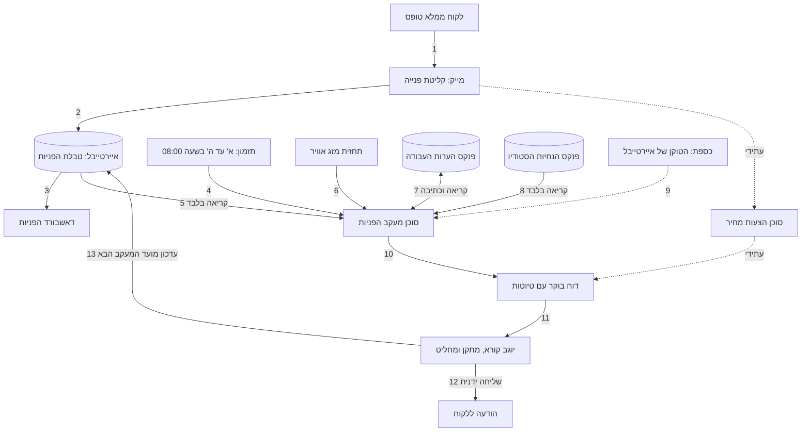
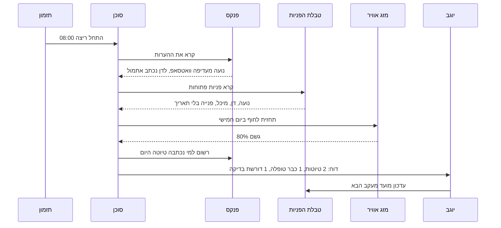

# ארכיטקטורה: מאיפה המידע מגיע ולאן הוא הולך

מסמך זה עונה על שאלה 4 במטלה של שיעור 6: מה גורם לסוכן לרוץ, מה עושים עם הפלט שלו, ואיך כל חלקי המערכת מתחברים. התכנון של הסוכן עצמו נמצא בקובץ `SPEC.md`.

---

## 1. התמונה המלאה

המערכת בנויה מארבעה חלקים שכבר קיימים, ומחלק חדש אחד, הסוכן.

| חלק | מה הוא עושה | מאיזה שיעור |
|---|---|---|
| טופס פנייה ותרחיש במייק (Make) | קולט פנייה חדשה ורושם אותה בטבלה | שיעור 5 |
| טבלת הפניות באיירטייבל (Airtable) | המקור היחיד לנתוני הפניות | שיעור 4 |
| דאשבורד הפניות | מציג לי את הפניות לפי שלבים | שיעורים 3 ו-4 |
| תחזית מזג אוויר מ-Open-Meteo | ממשק ציבורי לתחזית | בונוס שיעור 4 |
| **סוכן מעקב הפניות** | מכין לי כל בוקר טיוטות להודעות המשך | **שיעור 6, חדש** |

## 2. תרשים הזרימה

המספרים על החצים מתאימים להסבר שמתחת לתרשים.

## 3. ההסבר לכל חץ

**קליטה: איך פנייה נכנסת למערכת**
1. לקוח ממלא טופס באתר. הטופס שולח את הפנייה לכתובת ווב-הוק (webhook) של מייק.
2. מייק בודק שהפנייה תקינה ורושם אותה בטבלה, בשלב "פנייה חדשה". זה תרחיש קבוע, כי הצעדים תמיד זהים.
3. הדאשבורד קורא את הטבלה ומציג לי את הפניות.

**הסוכן: מה גורם לו לרוץ ומה הוא קורא**

4. **ההפעלה (trigger).** כל יום, מראשון עד חמישי, ב-08:00 לפי שעון ישראל. הפלטפורמה של Claude מפעילה אותו לבד, לפי תזמון (deployment). היא מפזרת הפעלות עד 9 דקות, ולכן הדוח מוכן עד 08:15.
5. הסוכן קורא את טבלת הפניות. ההרשאה היא קריאה בלבד, והוא לא יכול לשנות את הטבלה.
6. לצילומי חוץ ב-3 הימים הקרובים, הסוכן בודק תחזית מזג אוויר.
7. הסוכן קורא את פנקס הערות העבודה שלו: העדפות לקוחות, טיוטות שכבר נכתבו ולקחים. בסוף הריצה הוא מעדכן אותו.
8. הסוכן קורא את הנחיות הסטודיו: טון ההודעות, סוגי הצילום והמחירים. את הפנקס הזה הוא לא יכול לשנות.
9. הטוקן לאיירטייבל שמור בכספת (vault). הסוכן משתמש בו בלי לראות אותו. החץ מקווקו, כי זה לא מידע שהסוכן קורא אלא הרשאה שמוזרקת לבקשה.

**הפלט: מה עושים עם מה שהסוכן מוציא**

10. בסוף הריצה הסוכן מחזיר דוח: שורת סיכום, טיוטה לכל לקוח, ורשימה של פניות שדורשות בדיקה.
11. אני קורא את הדוח בצופה הריצות (session viewer) בקונסולה של Claude. אני מתקן טיוטה אם צריך, ומחליט למי לשלוח.
12. אני שולח את ההודעה ללקוח בעצמי, בוואטסאפ או במייל. **הסוכן אף פעם לא שולח בעצמו.**
13. אני מעדכן בטבלה את מועד המעקב הבא. זה סוגר את המעגל: מחר בבוקר הסוכן יקרא את התאריך החדש.

## 4. בוקר אחד, צעד אחר צעד

התרשים הזה מראה את סדר הפעולות בתוך ריצה אחת. השמות בדויים.

## 5. מי כותב לאיזה מקום

כל נתון נכתב רק במקום אחד. כך שני מקורות לא סותרים זה את זה.

| מקום | מי כותב בו | מי קורא ממנו |
|---|---|---|
| טבלת הפניות | מייק כותב פניות חדשות. אני מעדכן שלבים ותאריכים | הדאשבורד והסוכן |
| פנקס הערות העבודה | הסוכן בלבד | הסוכן בלבד |
| פנקס הנחיות הסטודיו | אני בלבד | הסוכן |
| דוח הבוקר | הסוכן | אני |

**הסוכן לא כותב לשום מערכת חיצונית.** הכתיבה היחידה שלו היא לפנקס שלו. זו החלטה מכוונת: כל שימוש בכלי הוא כתיבה, או עלול להיות כתיבה, ולכן הסוכן מקבל רק את הגישה המינימלית שהוא צריך.

## 6. איך אני עוקב שהסוכן עובד

בשיעור למדנו שלוש דרכים לעקוב אחרי סוכן. אני משתמש בשתיים מהן, כי אף אחד לא צופה בסוכן בזמן שהוא רץ.

| דרך | מה היא נותנת | איך אני משתמש בה |
|---|---|---|
| צופה הריצות בקונסולה | כל צעד, כל קריאה לכלי, ועלות הריצה | קורא את הדוח כל בוקר, ובודק ריצה שנראית לא תקינה |
| רשומות ההפעלות | האם התזמון הפעיל את הסוכן, ואם לא, למה | בודק פעם בשבוע שלא היו הפעלות שנכשלו |
| ווב-הוק (webhook) כשריצה נכשלת | הודעה מיידית על תקלה | שלב עתידי. כרגע מספיק לי לבדוק בבוקר |

## 7. גבולות האבטחה

1. **הטוקן לא נכנס לסביבה של הסוכן.** הוא נשמר בכספת, ומוזרק רק כשהבקשה יוצאת.
2. **רשת מוגבלת.** הסוכן יכול לגשת רק לשני אתרים: איירטייבל ו-Open-Meteo.
3. **קריאה בלבד מהטבלה.** גם אם הסוכן יטעה, הוא לא יכול למחוק או לשנות פנייה.
4. **אין כלי שליחה.** אין דרך שבה הודעה תגיע ללקוח בלי שאני שולח אותה.
5. **תקציב לריצה.** 0.50 דולר לכל ריצה, וטעינה אוטומטית של קרדיט כבויה.

## 8. שלבים עתידיים

הקווים המקווקווים בתרשים הם שלבים להמשך.

1. **סוכן הצעות מחיר.** הוא יופעל דרך ווב-הוק, כשמייק קולט פנייה חדשה, ויכין טיוטת הצעת מחיר. הוא סוכן נפרד, כי ההפעלה, הזיכרון וההרשאות שלו שונים. לפי העיקרון "חדר אחד לכל סוג עבודה", כל סוכן מקבל רק את מה שהוא צריך.
2. **שליחת הדוח אליי.** במייל או בוואטסאפ, במקום לפתוח את הקונסולה.
3. **כפתור "שלח" בדאשבורד.** ליד כל טיוטה, עם אישור שלי לפני כל שליחה.
